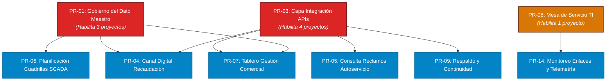

# SECCIÓN 7.1 · PORTAFOLIO DE PROYECTOS E INVERSIONES DE TI (PETI)
## EPS AGUAS DEL SUR S.A. · Período Estratégico 2026–2030

---

### 7.1.1 Marco Conceptual, Principios de Gobierno y Criterios de Admisión

El portafolio de proyectos de Tecnologías de Información de **EPS AGUAS DEL SUR S.A.** constituye el instrumento directivo que traduce los objetivos estratégicos institucionales y las brechas diagnosticadas en un conjunto coherente, priorizado y financiable de iniciativas de inversión y mejora continua.

Conforme a las mejores prácticas internacionales de gobierno y gestión de TI —específicamente **COBIT 2019 (objetivos de gobierno EDM02: *Asegurar la entrega de beneficios* y APO05: *Gestión del portafolio* )** y el marco **Val IT de ISACA**—, ninguna iniciativa tecnológica puede ser admitida ni presupuestada como un fin en sí misma o por mera inercia de compras. 

Para erradicar las malas prácticas históricas identificadas en la entidad (compras verbales, sobrecostos de hasta +62.5% y nula medición de beneficios), se establecen **tres filtros obligatorios de admisión al portafolio**:
1. **Trazabilidad a una Fuente Admisible:** La iniciativa debe originarse obligatoriamente en una de las seis fuentes formales del PETI: *Obligación normativa*, *Brecha de arquitectura empresarial*, *Brecha de capacidad de procesos*, *Estrategia FODA cruzada*, *Brecha de servicio digital* o *Brecha de línea base*. Se prohíbe el ingreso de solicitudes aisladas o propuestas discrecionales de proveedores.
2. **Alineamiento Estratégico Explícito:** Cada proyecto debe contribuir directamente a uno o más Objetivos Estratégicos de TI (OD-01 a OD-06). Las propuestas que no demuestren impacto medible sobre un indicador del plan son rechazadas.
3. **Evaluación Obligatoria de Alternativas y TCO:** Toda iniciativa de inversión debe formularse con un caso de negocio que evalúe al menos tres alternativas (incluyendo el *costo de no hacer nada*) y costee el ciclo de vida completo mediante el Costo Total de Propiedad (TCO a 5 años).

---

### 7.1.2 Portafolio Consolidado de Proyectos Candidatos Admitidos

Tras aplicar el control de admisión sobre las propuestas derivadas del diagnóstico estratégico, se admitieron formalmente **15 proyectos institucionales**, cubriendo la totalidad de las necesidades normativas, de resiliencia operativa y de modernización comercial de la empresa prestadora.

#### Tabla 7.1.1: Matriz Oficial del Portafolio de Proyectos de TI (EPS AGUAS DEL SUR S.A.)

| Código | Nombre del Proyecto | Fuente Admisible | Sección Origen PETI | Objetivos Asociados | Horizonte Estratégico |
|:---:|:---|:---|:---:|:---:|:---:|
| **PR-01** | Gobierno del dato maestro | Brecha de arquitectura | Sección 5.4.2 PT-01 | OD-02, OD-03 | Transformar |
| **PR-02** | Registro de actividades de tratamiento | Obligación normativa | Sección 4.1.5 | OD-05 | Operar |
| **PR-03** | Capa de integración de servicios (APIs / ESB) | Brecha de arquitectura | Sección 5.4.2 PT-02 | OD-01, OD-03 | Transformar |
| **PR-04** | Rediseño y adopción del canal digital B2B / Recaudación | Brecha de servicio digital | Sección 6.1.7 S-01 | OD-01 | Crecer |
| **PR-05** | Consulta de estado de reclamo y trámite en autoservicio | Brecha de servicio digital | Sección 6.1.7 S-02 | OD-01 | Crecer |
| **PR-06** | Planificación de rutas de cuadrillas y SCADA | Estrategia FODA | Sección 3.5 E-02 | OD-03 | Crecer |
| **PR-07** | Tablero de gestión comercial y operacional | Brecha de arquitectura | Sección 5.4.2 PT-05 | OD-02 | Crecer |
| **PR-08** | Mesa de servicio de TI (Gestión de incidentes) | Brecha de capacidad | Sección 4.3.5 DSS02 | OD-04 | Operar |
| **PR-09** | Continuidad de infraestructura y respaldo inmutable | Brecha de capacidad | Sección 4.3.5 DSS04 | OD-04 | Operar |
| **PR-10** | Renovación de la plataforma comercial y operacional (ERP) | Estrategia FODA | Sección 3.5 E-04 | OD-04 | Operar |
| **PR-11** | Programa de cumplimiento de datos personales (LPDP) | Obligación normativa | Sección 4.1.5 | OD-05 | Operar |
| **PR-12** | Gestión del conocimiento y de la configuración (CMDB) | Estrategia FODA | Sección 3.5 E-07 | OD-06 | Operar |
| **PR-13** | Comité de gobierno de TI y transformación digital | Brecha de capacidad | Sección 4.3.5 EDM01 | OD-02, OD-04 | Operar |
| **PR-14** | Instrumentación de monitoreo y disponibilidad de enlaces | Brecha de línea base | Sección 6.1.5 | OD-04 | Operar |
| **PR-15** | Autoservicio de trabajadores (boletas y permisos) | Brecha de servicio digital | Sección 6.1.7 S-09 | OD-01 | Crecer |

*Distribución por Objetivos Estratégicos:* OD-04 Continuidad y Seguridad (5 proyectos), OD-01 Atención Ciudadana (4 proyectos), OD-02 Decisión por Datos (3 proyectos), OD-03 Eficiencia y SCADA (3 proyectos), OD-05 Cumplimiento Legal (2 proyectos), OD-06 Gestión de Talento y TI (1 proyecto). Cobertura: 100%.

---

### 7.1.3 Análisis del Costo Total de Propiedad (TCO a 5 Años) y Compromiso Operativo

El costeo tradicional en EPS Aguas del Sur S.A. se limitaba a evaluar la factura inicial de compra (Capex), ignorando sistemáticamente los costos de licencias anuales, infraestructura, soporte post-garantía y personal dedicado.

El modelo de TCO a 5 años adoptado por la organización cuantifica:
$$\text{Costo Único} = \text{Inversión Inicial} + \text{Capacitación} + \text{Migración} + \text{Integración}$$
$$\text{Costo Anual Recurrente} = \text{Licencias} + \text{Infraestructura} + \text{Soporte (\% Capex)} + \text{Personal}$$
$$\text{TCO a 5 Años} = \text{Costo Único} + (\text{Costo Anual Recurrente} \times 5)$$

#### Tabla 7.1.2: Estructura Financiera de TCO a 5 Años por Proyecto (Ordenado por TCO)

| Código | Nombre del Proyecto | Inversión Inicial (S/) | Costo Único (S/) | Costo Anual Recurrente (S/) | TCO 5 Años (S/) | % Operativo del TCO | Margen de Incertidumbre |
|:---:|:---|:---:|:---:|:---:|:---:|:---:|:---:|
| **PR-09** | Continuidad y respaldo inmutable | 145 000 | 230 000 | 110 100 | **780 500** | 70.5 % | ±50 % |
| **PR-03** | Capa de integración de servicios | 78 000 | 101 000 | 71 640 | **459 200** | 78.0 % | ±40 % |
| **PR-04** | Rediseño y adopción canal digital | 92 000 | 128 000 | 59 400 | **425 000** | 69.9 % | ±35 % |
| **PR-01** | Gobierno del dato maestro | 55 000 | 81 000 | 41 850 | **290 250** | 72.1 % | ±30 % |
| **PR-05** | Consulta y reclamos autoservicio | 34 000 | 52 000 | 25 500 | **179 500** | 71.0 % | ±30 % |
| **PR-08** | Mesa de servicio de TI | 42 000 | 46 000 | 23 040 | **161 200** | 71.5 % | ±25 % |
| **PR-06** | Planificación rutas cuadrillas | 28 000 | 43 000 | 22 200 | **154 000** | 72.1 % | ±25 % |
| **PR-15** | Autoservicio trabajadores | 24 000 | 36 000 | 21 600 | **144 000** | 75.0 % | ±25 % |
| **PR-13** | Comité de gobierno de TI | 26 000 | 41 000 | 18 900 | **135 500** | 69.7 % | ±30 % |
| **PR-10** | Renovación ERP comercial | 22 000 | 28 000 | 20 200 | **129 000** | 78.3 % | ±25 % |
| **PR-12** | Gestión conocimiento (CMDB) | 19 000 | 26 000 | 11 880 | **85 400** | 69.6 % | ±25 % |
| **PR-14** | Instrumentación monitoreo | 14 000 | 20 000 | 13 080 | **85 400** | 76.6 % | ±20 % |
| **PR-02** | Registro actividades tratamiento | 18 000 | 21 000 | 10 800 | **75 000** | 72.0 % | ±20 % |
| **PR-07** | Tablero de gestión comercial | 15 000 | 20 000 | 9 300 | **66 500** | 69.9 % | ±20 % |
| **PR-11** | Cumplimiento datos personales | 6 000 | 8 000 | 3 000 | **23 000** | 65.2 % | ±15 % |
| **TOTAL** | **Portafolio Consolidado** | **S/ 618 000** | **S/ 881 000** | **S/ 462 490** | **S/ 3 193 450** | **72.4 %** | — |

#### Hallazgos Clave del Análisis de TCO:
1. **Factor Multiplicador de 5.17×:** El costo total de propiedad a 5 años (S/ 3 193 450) es **5.17 veces superior a la inversión inicial de compra** (S/ 618 000). Si la jefatura de TI presenta únicamente la inversión inicial ante la Gerencia General o el Directorio, se oculta un compromiso presupuestal recurrente de **S/ 2 575 450**.
2. **Proyectos con Mayor Arrastre Operativo:** Los proyectos PR-10 (78.3%), PR-03 (78.0%), PR-14 (76.6%), PR-15 (75.0%) y PR-01 (72.1%) demandan que más de tres cuartas partes de su financiamiento se destine a personal, licencias y soporte técnico. Esto exige planificar su absorción en las partidas operativas del presupuesto anual de TI (PT01 a PT05).
3. **Consistencia con la Telemetría de Pagos Reales:** La población de pagos del período analizada en `pagos.csv` evidencia que la empresa desembolsó **S/ 2 354 579.60 en 1 556 pagos de "Servicio informático"**. El gasto anual promedio derivado de dicho histórico (aprox. S/ 470 000 anuales) valida que la suma del costo anual recurrente de los 15 proyectos (S/ 462 490/año) es técnica y económicamente realista respecto a la capacidad de pago histórica de EPS Aguas del Sur S.A.

---

### 7.1.4 Casos de Negocio, Evaluación de Alternativas y Mitigación de Desviaciones Históricas

#### Línea Base Histórica: Defectos Críticos de las Inversiones Pasadas
El análisis forense de los tres expedientes de inversiones cerradas de la empresa (`expedientes-de-inversion.md`) revela vicios estructurales de gestión:
- **INV01 (Portal de autoservicio, 2024):** Aprobado en S/ 313 508.49, ejecutado en S/ 509 509.64 (**desviación de +62.5%**). Beneficio medido de forma "Parcial". Sin caso de negocio ni alternativas; se aceptó el servicio sin acta formal de recepción.
- **INV02 (Sistema de respaldo, 2024):** Aprobado en S/ 280 369.14, ejecutado en S/ 375 784.32 (**desviación de +34.0%**). Beneficio "Ahorro en licencias" clasificado como **No se midió**. Compra reactiva bajo justificación verbal de "evitar la parada operativa", con ampliación autorizada verbalmente.
- **INV03 (Enlace de datos redundante, 2023):** Aprobado en S/ 62 127.30, ejecutado en S/ 82 579.34 (**desviación de +32.9%**). Beneficio "Cumplimiento normativo" calificado como **No se midió**.
- **Diagnóstico Global:** Las tres inversiones acumularon un sobrecosto de **+S/ 311 868.37 (+47.5% de desviación media)**, en el 100% de los casos solo se solicitaron cotizaciones de la misma marca, y en ninguno existió acta de aceptación ni verificación ex-post de beneficios.

#### Evaluación de Alternativas Obligatorias bajo Val IT
Para los dos proyectos de mayor envergadura presupuestal se formularon casos de negocio evaluando tres alternativas:
1. **Alternativa A — No hacer nada (Costo de Inacción):** Pérdidas y sobrecostos en que incurre la EPS si no interviene.
2. **Alternativa B — Migrar o modernizar sobre la solución actual:** Menor riesgo inicial, pero arrastra deuda técnica.
3. **Alternativa C — Reemplazo por nueva solución tecnológica:** Mayor inversión inicial, elimina dependencias y habilita nuevas capacidades.

#### Tabla 7.1.3: Evaluación Financiera Comparativa de Alternativas a 5 Años

| Proyecto | Alternativa Evaluada | Inversión Inicial (S/) | Costo a 5 Años (S/) | Beneficio a 5 Años (S/) | Beneficio Neto 5 Años (S/) | Retorno (ROI %) | Decisión / Fundamento |
|:---|:---|:---:|:---:|:---:|:---:|:---:|:---|
| **PR-09** (Respaldo y Continuidad) | **A. No hacer nada** | 0 | 0 | -900 000 | **-900 000** | — | **Descartada:** La parálisis operativa del servicio y multas de SUNASS cuestan S/ 180k/año. Costo de inacción inaceptable. |
| | **B. Migrar versión proveedor** | 145 000 | 565 000 | 300 000 | **-265 000** | -46.9 % | **Descartada:** Mantiene cautividad de proveedor único sin garantizar respaldo inmutable ante ransomware. |
| | **C. Reemplazo Nube Híbrida** | 240 000 | 720 000 | 600 000 | **-120 000** | **-16.7 %** | **SELECCIONADA:** Menor pérdida neta global (ahorra S/ 780k frente a inacción). Garantiza resiliencia e inmutabilidad. |
| **PR-04** (Canal Digital y Recaudación) | **A. No hacer nada** | 0 | 0 | -475 000 | **-475 000** | — | **Descartada:** Mantener ventanillas físicas cuesta S/ 95k anuales en personal de caja y arqueos. |
| | **B. Rediseño Web/Móvil + APIs** | 92 000 | 380 000 | 725 000 | **+345 000** | **+90.8 %** | **SELECCIONADA:** Máximo retorno financiero y despresurización inmediata de ventanillas al conectarse con PR-03. |
| | **C. Nueva Plataforma Terceros** | 210 000 | 630 000 | 875 000 | **+245 000** | +38.9 % | **Descartada:** Alto costo de licenciamiento propietario y curva de adopción de más de 12 meses. |

---

### 7.1.5 Balance Estratégico del Portafolio (Operar / Crecer / Transformar)

#### Diagnóstico del Presupuesto Actual (`presupuesto_ti.csv`):
El presupuesto de TI institucional (S/ 1 080 000 planificado y S/ 863 629.34 ejecutado) exhibe un **ahogamiento operativo severo**:
- **Operación (PT01–PT05, PT07):** Concentra el **91.1 % del gasto ejecutado** (S/ 786 948.40) y el 92.0 % del planificado.
- **Inversión / Proyectos Nuevos (PT06):** Únicamente representa el **8.9 % ejecutado** (S/ 76 680.94) y 8.0 % planificado.
- **Transformación:** **0.0 %**. La empresa no destina un solo sol a rediseñar arquitecturas o cambiar su modelo operativo.

#### Balance Propuesto por el PETI 2026–2030 (Basado en TCO a 5 Años):
El portafolio rompe el paradigma reactivo y redistribuye los S/ 3 193 450 de TCO:
- **Operar:** **46.2 % del TCO** (S/ 1 475 000 en 8 proyectos) — *Rango de referencia: 50–70 %*.
- **Crecer:** **30.3 % del TCO** (S/ 969 000 en 5 proyectos) — *Rango de referencia: 20–30 %*.
- **Transformar:** **23.5 % del TCO** (S/ 749 450 en 2 proyectos) — *Rango de referencia: 10–20 %*.

#### Justificación Estratégica del Cambio de Balance:
1. **Descenso de Operar (de 91.1% a 46.2%):** Se reduce drásticamente la proporción del gasto absorbido por la rutina gracias a la consolidación de contratos, automatización de la mesa de ayuda (PR-08) y retiro de sistemas obsoletos.
2. **Sobre-inversión Transitoria en Transformar (23.5% vs 10–20% de referencia):** Esta concentración es deliberada y obligatoria en los primeros 18 meses. Para que EPS Aguas del Sur S.A. pueda digitalizar sus servicios al ciudadano y modernizar el SCADA, es indispensable construir primero los cimientos tecnológicos: el **Gobierno del Dato Maestro (PR-01)** y la **Capa de Integración mediante APIs (PR-03)**. Una vez implementados, el balance de transformación convergerá al 15% en el quinquenio posterior.

---

### 7.1.6 Mapa de Dependencias Arquitecturales y Secuenciamiento Topológico

El portafolio no puede ejecutarse de forma arbitraria; existen restricciones arquitecturales estrictas modeladas mediante teoría de grafos dirigidos acíclicos (DAG).

#### Análisis de la Red de Dependencias:
1. **Los Dos Super Habilitadores Estructurales:**
   - **PR-03 (Capa de Integración de Servicios):** Habilita directamente a 4 proyectos (PR-04, PR-05, PR-07 y PR-09). Si PR-03 se retrasa, el portal de pagos, el autoservicio de reclamos, los tableros analíticos y la sincronización de respaldos quedan bloqueados.
   - **PR-01 (Gobierno del Dato Maestro):** Habilita directamente a 3 proyectos (PR-04, PR-06 y PR-07). Sin un identificador único unificado de cliente catastral, las cuadrillas no pueden georreferenciar fugas y el portal comercial facturará erróneamente.
2. **Proyectos de Arranque Inmediato (Fase 1 - 9 Proyectos):**
   - No tienen dependencias previas y pueden licitarse de inmediato: **PR-01, PR-02, PR-03, PR-08, PR-10, PR-11, PR-12, PR-13 y PR-15**.
3. **Orden Topológico Estricto de Ejecución:**
   $$\text{PR-01} \rightarrow \text{PR-02} \rightarrow \text{PR-03} \rightarrow \text{PR-08} \rightarrow \text{PR-10} \rightarrow \text{PR-11} \rightarrow \text{PR-12} \rightarrow \text{PR-13} \rightarrow \text{PR-15} \rightarrow \text{PR-06} \rightarrow \text{PR-04} \rightarrow \text{PR-05} \rightarrow \text{PR-07} \rightarrow \text{PR-09} \rightarrow \text{PR-14}$$

---

### 7.1.7 Gobernanza del Portafolio y Medición de Valor (COBIT EDM02 y Val IT)

Para garantizar que el portafolio no sufra las desviaciones presupuestales (+47.5%) ni el abandono de beneficios de los expedientes anteriores, se formalizan tres salvaguardas directivas:
1. **Comité de Gobierno Digital y de TI (PR-13):** Es el único órgano facultado para autorizar el paso de un proyecto de una fase a la siguiente (*Stage-Gate Process*). Quedan estrictamente prohibidas las aprobaciones verbales de ampliaciones presupuestales. Toda desviación mayor al 10% exige adenda justificada con recálculo de TCO.
2. **Acta Formal de Recepción y Conformidad Técnica:** No se efectuará la liquidación financiera de ninguna orden de compra o servicio informático sin un acta suscrita por el líder técnico de TI y el usuario líder del área de negocio, verificando la entrega completa de documentación, manuales, código fuente y pruebas de seguridad.
3. **Comité de Medición de Beneficios Ex-Post:** Transcurridos 6 y 12 meses de la puesta en producción de cada proyecto, la Oficina de Planeamiento y TI presentará un informe cuantitativo contrastando el beneficio real logrado contra el beneficio declarado en el caso de negocio (eliminando el estado de «No se midió»).

