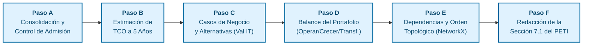
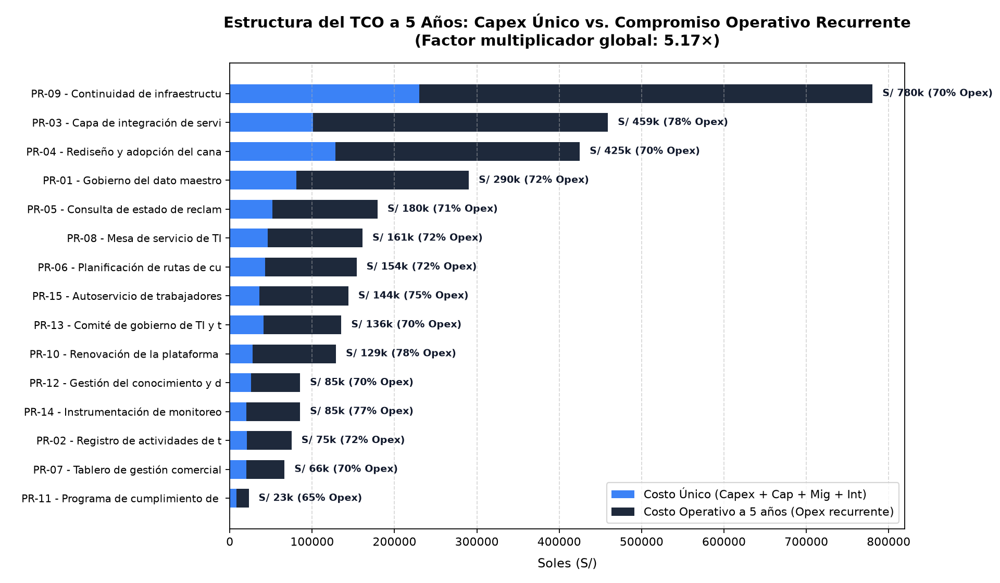
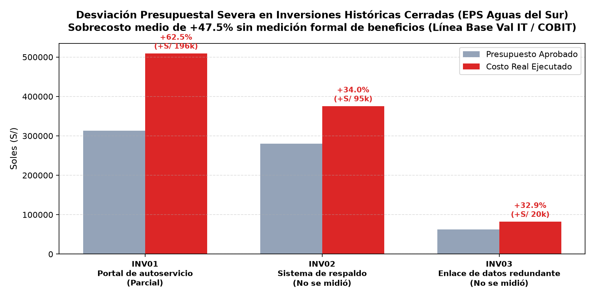
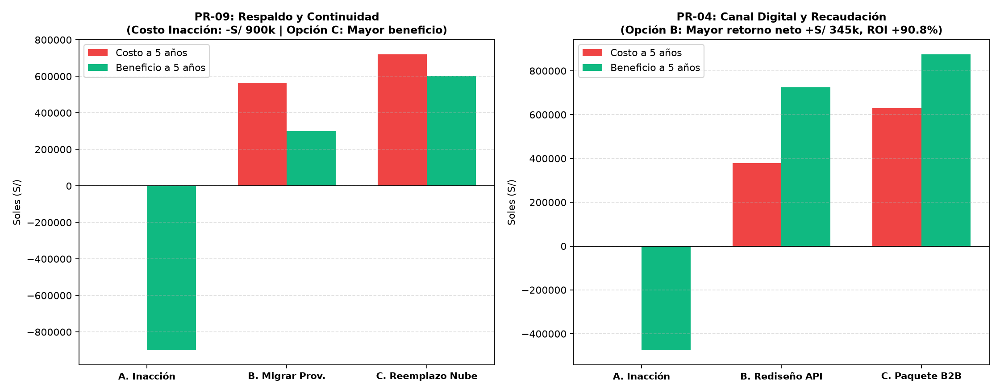
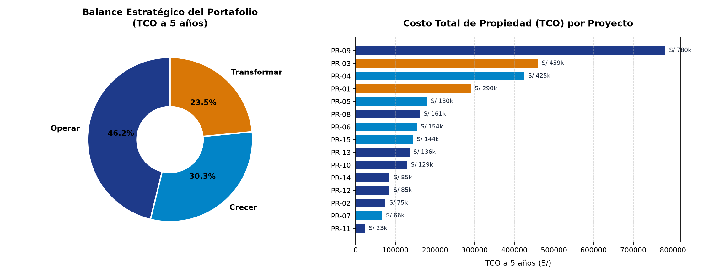
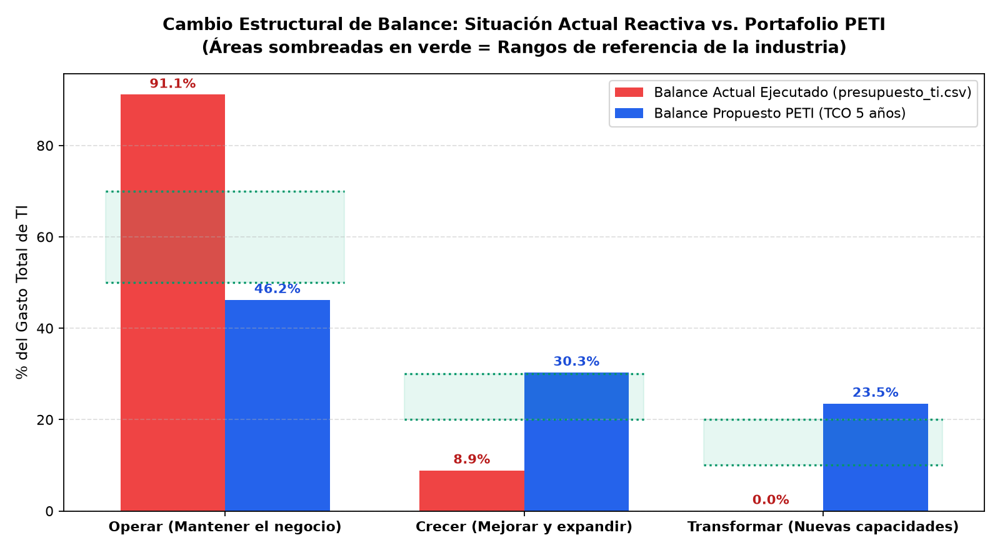
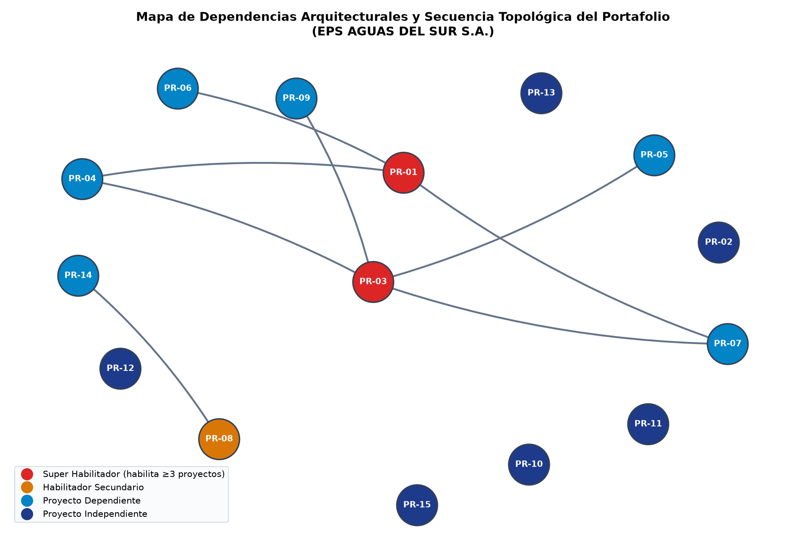
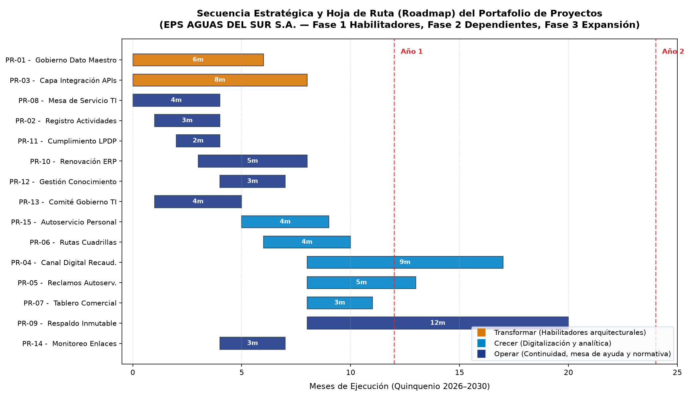

# INFORME DE LABORATORIO · TALLER SEMANA 13
## Construcción del Portafolio de Proyectos de TI y Casos de Negocio

---

<div align="center">

### UNIVERSIDAD PRIVADA DE TACNA
**FACULTAD DE INGENIERÍA**  
**Escuela Profesional de Ingeniería de Sistemas**

---

**ASIGNATURA:**  
Planeamiento Estratégico de Tecnologías de Información (SI-886)  
Semestre Académico 2026-II

**DOCENTE:**  
Dr. Oscar Juan Jimenez Flores

**CASO DE ESTUDIO:**  
EMPRESA 08 — **EPS AGUAS DEL SUR S.A.**  
*(Servicio Público de Agua Potable y Alcantarillado)*

**INTEGRANTE / EQUIPO DE TRABAJO (GRUPO 08):**  
Ramos Fabricio · Código Estudiantil: 2023076798

Pacompía Abel · Código Estudiantil: 2023076797

Colque Rodrigo · Código Estudiantil: 2023077078

**ENLACE AL REPOSITORIO DE GITHUB:**  
[https://github.com/FabricioRams/SI886-S13-TALLER-Grupo8](https://github.com/FabricioRams/SI886-S13-TALLER-Grupo8)

Tacna, Perú  
Noviembre 2026

</div>

---

## 1. Información General y Objetivos del Taller

### 1.1 Objetivos de la Práctica
- Aplicar el **control de admisión de proyectos candidatos** al portafolio de TI, verificando la trazabilidad estricta a fuentes formales admisibles (*Obligación normativa*, *Brecha de arquitectura empresarial*, *Brecha de capacidad*, *Estrategia FODA cruzada*, *Brecha de servicio digital* y *Brecha de línea base*) y descartando iniciativas discrecionales o sin alineamiento estratégico.
- Calcular cuantitativamente el **Costo Total de Propiedad (TCO a 5 años)** de cada iniciativa admitida, desglosando los costos únicos de implantación frente al compromiso recurrente de licencias, infraestructura, soporte anual y personal dedicado.
- Realizar un **análisis forense de la línea base histórica** de inversiones cerradas de la empresa (`expedientes-de-inversion.md` e `inversiones_cerradas.csv`), identificando los patrones de sobrecosto (+32.9% a +62.5%), la ausencia de actas formales de aceptación y el abandono de la medición de beneficios.
- Evaluar rigurosamente **casos de negocio con tres alternativas** obligatorias bajo el marco **Val IT de ISACA** y **COBIT 2019 (EDM02)** en los proyectos de mayor impacto y riesgo presupuestal, cuantificando monetariamente el *costo de no hacer nada (inacción)* frente a la modernización y el reemplazo.
- Determinar el **balance estratégico del portafolio** por horizontes de inversión (*Operar*, *Crecer* y *Transformar*) sustentado en TCO a 5 años, contrastándolo con los rangos de referencia metodológica y con el presupuesto actual ejecutado de la empresa (`presupuesto_ti.csv`).
- Modelar las **dependencias arquitecturales mediante grafos dirigidos acíclicos (DAG)** en Python con NetworkX, derivando el **orden topológico estricto** de ejecución, los proyectos super habilitadores y las iniciativas de inicio inmediato.
- Redactar formalmente la **Sección 7.1 del Plan Estratégico de TI (PETI)** consolidando las reglas de gobernanza (*Stage-Gate Process* y medición de valor ex-post).

### 1.2 Tecnologías y Herramientas Aplicadas
- **Python 3.14 + pandas + numpy + matplotlib + networkx:** Procesamiento analítico de matrices de portafolio, cálculo matricial del TCO a 5 años, análisis financiero de flujos de alternativas (ROI y valor neto), modelamiento de teoría de grafos y generación automatizada de figuras vectoriales de alta resolución.
- **Auditoría de Datos Contables y Financieros:** Procesamiento y agregación de la población completa de pagos institucionales (`Recursos/pagos.csv`, con 19 281 registros transaccionales) y de la ejecución presupuestal de TI (`Recursos/presupuesto_ti.csv`).
- **Git / GitHub:** Control de versiones distribuido, estructuración de artefactos reproducibles en carpetas modulares (`07_portafolio/`, `graficos/`, `evidencias/S13/`), y etiquetado formal (`v0.13` y `taller-13`).

### 1.3 Seguridad y Confidencialidad
- La información financiera de facturación anual de la entidad (S/ 74.1 millones), el presupuesto anual de TI (S/ 1.08 millones) y los registros de pagos a proveedores de servicios informáticos se gestionan con estricta reserva técnica conforme a la Ley N.° 29733 (Ley de Protección de Datos Personales).
- Los modelos analíticos se procesan en entorno local sin exponer secretos de conexión, credenciales de administración de bases de datos ni datos de clientes regulados de las 86 000 conexiones de agua potable de Tacna.

---

## 2. Procedimiento Metodológico y Resultados Obtenidos Paso a Paso



---

### Paso A — Consolidación y Control de Admisión de Proyectos Candidatos

El portafolio no puede ser una "lista de deseos" desarticulada. Para garantizar la gobernanza conforme a **COBIT 2019 (APO05: Gestión de Portafolio)**, se estableció un **filtro estricto de control de admisión**:
1. **Regla de Fuente Válida:** Solo califican proyectos que resuelvan una causa raíz documentada en las secciones previas del PETI: *Obligación normativa*, *Brecha de arquitectura*, *Brecha de capacidad*, *Estrategia FODA*, *Brecha de servicio digital* o *Brecha de línea base*. Se rechaza cualquier propuesta sin origen demostrable.
2. **Regla de Cobertura Estratégica:** Todo proyecto admitido debe asociarse a uno o más Objetivos Estratégicos de TI (OD-01 a OD-06).

A través del script [`07_portafolio/PF01_consolidacion.py`](https://github.com/FabricioRams/SI886-S13-TALLER-Grupo8/blob/main/07_portafolio/PF01_consolidacion.py), se procesaron las 15 iniciativas candidatas, superando el control de admisión con **0 candidatos rechazados**, y consolidándose en el archivo [`07_portafolio/PF01_portafolio_candidatos.csv`](https://github.com/FabricioRams/SI886-S13-TALLER-Grupo8/blob/main/07_portafolio/PF01_portafolio_candidatos.csv).

#### Tabla 1: Portafolio Oficial de Proyectos Candidatos Admitidos (EPS AGUAS DEL SUR S.A.)

| Código | Nombre del Proyecto | Fuente Admisible | Sección Origen en PETI | Objetivos Estratégicos Asociados | Categoría Estratégica |
|:---:|:---|:---|:---:|:---:|:---:|
| **PR-01** | Gobierno del dato maestro | Brecha de arquitectura | Sección 5.4.2 PT-01 | OD-02, OD-03 | Transformar |
| **PR-02** | Registro de actividades de tratamiento | Obligación normativa | Sección 4.1.5 | OD-05 | Operar |
| **PR-03** | Capa de integración de servicios (APIs / ESB) | Brecha de arquitectura | Sección 5.4.2 PT-02 | OD-01, OD-03 | Transformar |
| **PR-04** | Rediseño y adopción del canal digital B2B / Recaudación | Brecha de servicio digital | Sección 6.1.7 S-01 | OD-01 | Crecer |
| **PR-05** | Consulta de estado de reclamo y trámite en autoservicio | Brecha de servicio digital | Sección 6.1.7 S-02 | OD-01 | Crecer |
| **PR-06** | Planificación de rutas de cuadrillas y SCADA | Estrategia FODA | Sección 3.5 E-02 | OD-03 | Crecer |
| **PR-07** | Tablero de gestión comercial y operacional | Brecha de arquitectura | Sección 5.4.2 PT-05 | OD-02 | Crecer |
| **PR-08** | Mesa de servicio de TI (Gestión de incidentes) | Brecha de capacidad | Sección 4.3.5 DSS02 | OD-04 | Operar |
| **PR-09** | Continuidad de infraestructura y respaldo inmutable | Brecha de capacidad | Sección 4.3.5 DSS04 | OD-04 | Operar |
| **PR-10** | Renovación de la plataforma comercial y operacional (ERP) | Estrategia FODA | Sección 3.5 E-04 | OD-04 | Operar |
| **PR-11** | Programa de cumplimiento de datos personales (LPDP) | Obligación normativa | Sección 4.1.5 | OD-05 | Operar |
| **PR-12** | Gestión del conocimiento y de la configuración (CMDB) | Estrategia FODA | Sección 3.5 E-07 | OD-06 | Operar |
| **PR-13** | Comité de gobierno de TI y transformación digital | Brecha de capacidad | Sección 4.3.5 EDM01 | OD-02, OD-04 | Operar |
| **PR-14** | Instrumentación de monitoreo y disponibilidad de enlaces | Brecha de línea base | Sección 6.1.5 | OD-04 | Operar |
| **PR-15** | Autoservicio de trabajadores (boletas y vacaciones) | Brecha de servicio digital | Sección 6.1.7 S-06, S-07 | OD-01 | Crecer |

#### Análisis de Distribución y Cobertura:
- **Distribución por Fuente:** Brecha de arquitectura (3), Brecha de servicio digital (3), Estrategia FODA (3), Brecha de capacidad (3), Obligación normativa (2) y Brecha de línea base (1). Demuestra un balance riguroso de orígenes.
- **Distribución por Categoría:** Operar (8 proyectos = 53.3%), Crecer (5 proyectos = 33.3%) y Transformar (2 proyectos = 13.3%).
- **Cobertura de Objetivos Estratégicos:** OD-04 (5 proyectos), OD-01 (4 proyectos), OD-02 (3 proyectos), OD-03 (3 proyectos), OD-05 (2 proyectos) y OD-06 (1 proyecto). **Cobertura estratégica del 100%**.

```text
=== CONTROL DE ADMISIÓN ===
Candidatos sin fuente admisible: 0 → se retiran: []
Candidatos sin objetivo asociado: 0 → se retiran o se justifican

Proyectos admitidos: 15

Por fuente:
 fuente
Brecha de arquitectura        3
Brecha de servicio digital    3
Estrategia FODA               3
Brecha de capacidad           3
Obligación normativa          2
Brecha de línea base          1

Por categoría:
 categoria
Operar         8
Crecer         5
Transformar    2

=== COBERTURA DE OBJETIVOS ESTRATÉGICOS (OD) ===
objetivo
OD-04    5
OD-01    4
OD-02    3
OD-03    3
OD-05    2
OD-06    1
→ Todo objetivo estratégico debe tener al menos un proyecto asignado.
```
**Figura 1: Log de ejecución del programa `07_portafolio/PF01_consolidacion.py` archivado en `evidencias/S13/salidas/salida_PF01_consolidacion.txt`.**

---

### Paso B — Estimación del Costo Total de Propiedad (TCO a 5 Años) y Gasto Operativo

En las empresas de saneamiento y el sector público suele incurrirse en la miopía del Capex: evaluar adquisiciones únicamente por la cotización inicial, sin prever el arrastre financiero de licencias, soporte, infraestructura y personal durante el ciclo de vida de la solución.

El script [`07_portafolio/PF02_tco.py`](https://github.com/FabricioRams/SI886-S13-TALLER-Grupo8/blob/main/07_portafolio/PF02_tco.py) modela la formulación completa del TCO a 5 años para cada uno de los 15 proyectos admitidos, generando el archivo [`07_portafolio/PF02_tco.csv`](https://github.com/FabricioRams/SI886-S13-TALLER-Grupo8/blob/main/07_portafolio/PF02_tco.csv).

#### Tabla 2: Matriz Financiera de TCO a 5 Años del Portafolio (EPS AGUAS DEL SUR S.A.)

| Código | Proyecto | Inversión Inicial (S/) | Costo Único (S/) | Costo Anual Recurrente (S/) | TCO 5 Años (S/) | % Operativo | Margen Incertidumbre |
|:---:|:---|:---:|:---:|:---:|:---:|:---:|:---:|
| **PR-09** | Continuidad y respaldo inmutable | 145 000 | 230 000 | 110 100 | **780 500** | 70.5 % | ±50 % |
| **PR-03** | Capa de integración de servicios | 78 000 | 101 000 | 71 640 | **459 200** | 78.0 % | ±40 % |
| **PR-04** | Rediseño y adopción canal digital | 92 000 | 128 000 | 59 400 | **425 000** | 69.9 % | ±35 % |
| **PR-01** | Gobierno del dato maestro | 55 000 | 81 000 | 41 850 | **290 250** | 72.1 % | ±30 % |
| **PR-05** | Consulta y reclamos autoservicio | 34 000 | 52 000 | 25 500 | **179 500** | 71.0 % | ±30 % |
| **PR-08** | Mesa de servicio de TI | 42 000 | 46 000 | 23 040 | **161 200** | 71.5 % | ±25 % |
| **PR-06** | Planificación rutas cuadrillas | 28 000 | 43 000 | 22 200 | **154 000** | 72.1 % | ±25 % |
| **PR-15** | Autoservicio trabajadores | 24 000 | 36 000 | 21 600 | **144 000** | 75.0 % | ±25 % |
| **PR-13** | Comité de gobierno de TI | 26 000 | 41 000 | 18 900 | **135 500** | 69.7 % | ±30 % |
| **PR-10** | Renovación ERP comercial | 22 000 | 28 000 | 20 200 | **129 000** | 78.3 % | ±25 % |
| **PR-12** | Gestión conocimiento (CMDB) | 19 000 | 26 000 | 11 880 | **85 400** | 69.6 % | ±25 % |
| **PR-14** | Instrumentación monitoreo | 14 000 | 20 000 | 13 080 | **85 400** | 76.6 % | ±20 % |
| **PR-02** | Registro actividades tratamiento | 18 000 | 21 000 | 10 800 | **75 000** | 72.0 % | ±20 % |
| **PR-07** | Tablero de gestión comercial | 15 000 | 20 000 | 9 300 | **66 500** | 69.9 % | ±20 % |
| **PR-11** | Cumplimiento datos personales | 6 000 | 8 000 | 3 000 | **23 000** | 65.2 % | ±15 % |
| **TOTAL** | **Consolidado del Portafolio** | **S/ 618 000** | **S/ 881 000** | **S/ 462 490** | **S/ 3 193 450** | **72.4 %** | — |

#### Hallazgos y Conclusiones del Cálculo de TCO:
1. **Factor TCO / Inversión Inicial (5.17×):** La inversión inicial total es de **S/ 618 000**, mientras que el TCO a 5 años suma **S/ 3 193 450**. Esto significa que por cada sol aprobado en inversión inicial, la organización asume un compromiso financiero total de **S/ 5.17**. Ocultar esto ante la Gerencia General subestima el compromiso institucional en más de **S/ 2.57 millones**.
2. **Proyectos con Mayor Arrastre Operativo:** Encabezados por PR-10 (78.3%), PR-03 (78.0%), PR-14 (76.6%), PR-15 (75.0%) y PR-01 (72.1%). Estos proyectos exigen que el área de Finanzas asegure la sostenibilidad de las partidas de licencias y soporte en los años 2 a 5.
3. **Validación contra la Telemetría Real de Pagos (`pagos.csv`):** El análisis de la población completa de pagos revela **1 556 registros de "Servicio informático" por un total de S/ 2 354 579.60** ejecutados en el periodo (aprox. S/ 470 000 al año). Este hallazgo empírico valida que el costo operativo anual del nuevo portafolio (**S/ 462 490/año**) es perfectamente absorbible y consistente con la capacidad histórica de desembolso de la empresa.

  
**Figura 2: Estructura del Costo Total de Propiedad a 5 años: Costo Único de Implementación frente al Compromiso Operativo Recurrente (EPS Aguas del Sur S.A.).**

```text
=== COSTO TOTAL DE PROPIEDAD A 5 AÑOS ===
codigo  inv_inicial  costo_unico  costo_anual    tco_5  pct_operativo incertidumbre
 PR-09       145000       230000     110100.0 780500.0           70.5         ±50 %
 PR-03        78000       101000      71640.0 459200.0           78.0         ±40 %
 PR-04        92000       128000      59400.0 425000.0           69.9         ±35 %
 PR-01        55000        81000      41850.0 290250.0           72.1         ±30 %
 PR-05        34000        52000      25500.0 179500.0           71.0         ±30 %
 PR-08        42000        46000      23040.0 161200.0           71.5         ±25 %
 PR-06        28000        43000      22200.0 154000.0           72.1         ±25 %
 PR-15        24000        36000      21600.0 144000.0           75.0         ±25 %
 PR-13        26000        41000      18900.0 135500.0           69.7         ±30 %
 PR-10        22000        28000      20200.0 129000.0           78.3         ±25 %
 PR-12        19000        26000      11880.0  85400.0           69.6         ±25 %
 PR-14        14000        20000      13080.0  85400.0           76.6         ±20 %
 PR-02        18000        21000      10800.0  75000.0           72.0         ±20 %
 PR-07        15000        20000       9300.0  66500.0           69.9         ±20 %
 PR-11         6000         8000       3000.0  23000.0           65.2         ±15 %

Inversión inicial total : S/ 618,000
Costo único total       : S/ 881,000
Costo operativo a 5 años: S/ 2,312,450
TCO total a 5 años      : S/ 3,193,450
Factor TCO/inversión    : 5.17×

→ El TCO es 5.2 veces la inversión inicial. Presentar solo la inversión
  inicial ante la gerencia subestima el compromiso en S/ 2,575,450.

=== PROYECTOS CON MAYOR PROPORCIÓN DE COSTO OPERATIVO ===
codigo    tco_5  pct_operativo
 PR-10 129000.0           78.3
 PR-03 459200.0           78.0
 PR-14  85400.0           76.6
 PR-15 144000.0           75.0
 PR-01 290250.0           72.1
→ Estos comprometen el presupuesto recurrente durante años: exigen mayor escrutinio.
```
**Figura 3: Log de ejecución del programa `07_portafolio/PF02_tco.py` guardado en `evidencias/S13/salidas/salida_PF02_tco.txt`.**

---

### Paso C — Casos de Negocio, Evaluación de Alternativas y Análisis Histórico

#### Análisis Forense de Inversiones Históricas Cerradas (`expedientes-de-inversion.md`):
La evidencia documental de las tres inversiones cerradas en EPS Aguas del Sur S.A. sustenta la necesidad de implementar **COBIT 2019 (EDM02)** y **Val IT**:
- **INV01 (Portal de autoservicio, 2024):** Presupuesto aprobado de S/ 313 508.49 frente a un costo ejecutado de S/ 509 509.64 (**desviación crítica de +62.5%** = +S/ 196 001.15). Se justificó por fin de soporte de versión; no se evaluaron alternativas (solo 3 cotizaciones del mismo producto), no se firmó acta formal de aceptación y el beneficio se midió como "Parcial".
- **INV02 (Sistema de respaldo, 2024):** Presupuesto de S/ 280 369.14 frente a S/ 375 784.32 ejecutado (**desviación de +34.0%** = +S/ 95 415.18). Justificación verbal de "evitar parada operativa", ampliación autorizada verbalmente por Gerencia, y el beneficio declarado ("Ahorro en licencias") fue categorizado como **No se midió**.
- **INV03 (Enlace de datos redundante, 2023):** Presupuesto de S/ 62 127.30 frente a S/ 82 579.34 ejecutado (**desviación de +32.9%** = +S/ 20 452.04). Beneficio "Cumplimiento normativo" calificado como **No se midió**.
- **Síntesis:** Un sobrecosto consolidado de **+S/ 311 868.37 (+47.5% de desviación media)**, sin análisis de alternativas ni control ex-post de valor.

  
**Figura 4: Desviación presupuestal severa en las tres inversiones históricas cerradas y su estado de medición de beneficios (EPS Aguas del Sur S.A.).**

#### Evaluación de Alternativas en Proyectos Clave (`07_portafolio/PF04_alternativas.py`):
Se evaluaron rigurosamente tres alternativas para PR-09 y PR-04, cuantificando monetariamente el impacto de la inacción y los retornos a 5 años, registrado en [`07_portafolio/PF04_alternativas.csv`](https://github.com/FabricioRams/SI886-S13-TALLER-Grupo8/blob/main/07_portafolio/PF04_alternativas.csv).

#### Tabla 3: Matriz de Evaluación Financiera de Alternativas a 5 Años

| Proyecto | Alternativa | Inversión Inicial (S/) | Costo a 5 Años (S/) | Beneficio a 5 Años (S/) | Beneficio Neto 5 Años (S/) | Retorno (ROI %) | Decisión Técnica / Sustento Metodológico |
|:---|:---|:---:|:---:|:---:|:---:|:---:|:---|
| **PR-09** (Respaldo y Continuidad) | **A. No hacer nada** | 0 | 0 | -900 000 | **-900 000** | — | **Descartada:** La parálisis operativa del servicio y multas de SUNASS representan -S/ 180 000/año. Costo de inacción intolerable. |
| | **B. Migrar versión proveedor** | 145 000 | 565 000 | 300 000 | **-265 000** | -46.9 % | **Descartada:** Mantiene cautividad de proveedor único y no resuelve la vulnerabilidad de ransomware. |
| | **C. Reemplazo Nube Híbrida** | 240 000 | 720 000 | 600 000 | **-120 000** | **-16.7 %** | **SELECCIONADA:** Menor pérdida neta global; evita un quebranto de S/ 900k y garantiza respaldo inmutable ante ciberataques. |
| **PR-04** (Canal Digital y Recaudación) | **A. No hacer nada** | 0 | 0 | -475 000 | **-475 000** | — | **Descartada:** Mantener ventanillas físicas cuesta S/ 95 000 anuales en cajeros, arqueos y pérdidas por mora. |
| | **B. Rediseño Web/Móvil + APIs** | 92 000 | 380 000 | 725 000 | **+345 000** | **+90.8 %** | **SELECCIONADA:** Máximo retorno y sinergia nativa con la capa de integración PR-03 para recaudación 24/7. |
| | **C. Paquete Comercial Terceros** | 210 000 | 630 000 | 875 000 | **+245 000** | +38.9 % | **Descartada:** Elevado Capex y complejidad de parametrización superior a 12 meses. |

  
**Figura 5: Comparativa económica de alternativas a 5 años para PR-09 y PR-04: Costos, Beneficios y Costo de la Inacción (EPS Aguas del Sur S.A.).**

```text
===============================================================================================
Proyecto PR-04
                                           alternativa  inv_inicial  costo_5  beneficio_5  neto_5  retorno
                                      A. No hacer nada            0        0      -475000 -475000      NaN
 B. Rediseño web/móvil con pasarela y arquitectura API        92000   380000       725000  345000     90.8
 C. Nueva plataforma comercial paquetizada de terceros       210000   630000       875000  245000     38.9
→ Mayor beneficio neto a 5 años: B. Rediseño web/móvil con pasarela y arquitectura API (S/ 345,000)
→ Costo de la inacción a 5 años: S/ 475,000

===============================================================================================
Proyecto PR-09
                                                alternativa  inv_inicial  costo_5  beneficio_5  neto_5  retorno
                                           A. No hacer nada            0        0      -900000 -900000      NaN
       B. Migrar a la versión soportada del mismo proveedor       145000   565000       300000 -265000    -46.9
 C. Reemplazar por otra solución (Nube híbrida e inmutable)       240000   720000       600000 -120000    -16.7
→ Mayor beneficio neto a 5 años: C. Reemplazar por otra solución (Nube híbrida e inmutable) (S/ -120,000)
→ Costo de la inacción a 5 años: S/ 900,000

✔ Archivo PF04_alternativas.csv generado exitosamente.
```
**Figura 6: Log de ejecución del programa `07_portafolio/PF04_alternativas.py` guardado en `evidencias/S13/salidas/salida_PF04_alternativas.txt`.**

---

### Paso D — Balance Estratégico del Portafolio (Operar / Crecer / Transformar)

Mediante el script [`07_portafolio/PF05_balance.py`](https://github.com/FabricioRams/SI886-S13-TALLER-Grupo8/blob/main/07_portafolio/PF05_balance.py), se evaluó el cambio en la composición del gasto tecnológico entre la situación actual de la EPS y la cartera quinquenal propuesta.

#### Diagnóstico del Presupuesto Actual (`presupuesto_ti.csv`):
- Total planificado: S/ 1 080 000 (1.46% de facturación); ejecutado real: S/ 863 629.34.
- **Operación (PT01–PT05, PT07):** Representa el **91.1 % ejecutado** (S/ 786 948.40) y 92.0 % planificado.
- **Inversión / Nuevos Proyectos (PT06):** Únicamente **8.9 % ejecutado** (S/ 76 680.94) y 8.0 % planificado.
- **Transformación:** **0.0 %**. Diagnóstico: Organización atrapada en un modelo reactivo («apagar incendios»).

#### Tabla 4: Balance del Portafolio Propuesto frente a las Proporciones de Referencia

| Categoría Estratégica | N.º Proyectos | Inversión Inicial (S/) | % Inversión | TCO 5 Años (S/) | % del TCO | Rango de Referencia de la Industria | Evaluación Metodológica |
|:---|:---:|:---:|:---:|:---:|:---:|:---:|:---|
| **Operar** (Mantener el negocio) | 8 | 292 000 | 47.2 % | 1 475 000 | **46.2 %** | 50 – 70 % | **POR DEBAJO:** Libera presupuesto corriente hacia innovación |
| **Crecer** (Expandir capacidades) | 5 | 193 000 | 31.2 % | 969 000 | **30.3 %** | 20 – 30 % | **DENTRO DEL RANGO:** Impulsa recaudación digital y SCADA |
| **Transformar** (Nuevas capacidades) | 2 | 133 000 | 21.5 % | 749 450 | **23.5 %** | 10 – 20 % | **POR ENCIMA:** Sobre-inversión deliberada en datos y APIs |
| **TOTAL** | **15** | **S/ 618 000** | **100 %** | **S/ 3 193 450** | **100 %** | — | **Estructura equilibrada e innovadora** |

#### Justificación del Cambio de Balance:
La aparente anomalía de tener **Transformar en 23.5%** (por encima del 10–20% de referencia) se sustenta técnicamente: EPS Aguas del Sur S.A. arrastra una deuda técnica severa en arquitectura. Para poder crecer en canales digitales, es indispensable construir primero los cimientos estructurales: **PR-01 (Gobierno del dato maestro)** y **PR-03 (Capa de integración de servicios)**. Una vez implementados en los primeros 18 meses, el balance convergerá al rango estándar.

  
**Figura 7: Balance estratégico del portafolio por TCO a 5 años y distribución de costos por proyecto (EPS Aguas del Sur S.A.).**

  
**Figura 8: Comparación del balance de gasto: Situación actual reactiva (presupuesto_ti.csv) vs. Portafolio estratégico PETI frente a rangos de referencia.**

```text
=== BALANCE DEL PORTAFOLIO PROHIBIDO (TCO A 5 AÑOS) ===
  categoria  proyectos  inversion       tco  pct_inv  pct_tco
     Operar          8     292000 1475000.0     47.2     46.2
     Crecer          5     193000  969000.0     31.2     30.3
Transformar          2     133000  749450.0     21.5     23.5

Contraste con las proporciones de referencia de la industria:
  Operar      :  46.2 % del TCO  (referencia 50–70 %)  → POR DEBAJO
  Crecer      :  30.3 % del TCO  (referencia 20–30 %)  → POR ENCIMA
  Transformar :  23.5 % del TCO  (referencia 10–20 %)  → POR ENCIMA

=== COMPARACIÓN CON EL BALANCE ACTUAL DE LA ORGANIZACIÓN ===
  Balance actual ejecutado (presupuesto_ti.csv) : Operar 91.1 % · Crecer/Inversión 8.9 % · Transformar 0.0 %
  Balance actual planificado (presupuesto_ti.csv): Operar 92.0 % · Crecer/Inversión 8.0 % · Transformar 0.0 %
  Balance propuesto por el PETI (TCO 5 años)    : Operar 46.2 % · Crecer 30.3 % · Transformar 23.5 %
→ El PETI desmantela el modelo reactivo ('apagar incendios') y destina 53.8 % de los recursos a modernización y transformación.
✔ Gráfico ../graficos/PF_balance.png generado con éxito.
```
**Figura 9: Log de ejecución del programa `07_portafolio/PF05_balance.py` archivado en `evidencias/S13/salidas/salida_PF05_balance.txt`.**

---

### Paso E — Mapa de Dependencias Arquitecturales y Secuenciamiento Topológico

Para evitar fallas de implantación por dependencias no resueltas, se modelaron las restricciones de precedencia en [`07_portafolio/PF06_dependencias.py`](https://github.com/FabricioRams/SI886-S13-TALLER-Grupo8/blob/main/07_portafolio/PF06_dependencias.py) con **NetworkX**.

#### Hallazgos Estructurales de la Red:
1. **Verificación de Aciclicidad:** El grafo carece de ciclos recursivos, garantizando la existencia de un orden topológico viable.
2. **Los Super Habilitadores Estructurales:**
   - **PR-03 (Capa de integración de servicios):** Habilita **4 proyectos** (PR-04, PR-05, PR-07 y PR-09). Cualquier retraso en PR-03 congela la modernización transaccional de la EPS.
   - **PR-01 (Gobierno del dato maestro):** Habilita **3 proyectos** (PR-04, PR-06 y PR-07). Es el cimiento de la unicidad del catastro de conexiones y telemetría SCADA.
   - **PR-08 (Mesa de servicio de TI):** Habilita **1 proyecto** (PR-14: Instrumentación de monitoreo).
3. **Proyectos de Arranque Inmediato (In-Degree = 0):**
   - Pueden licitarse de forma paralela en la Fase 1: **PR-01, PR-02, PR-03, PR-08, PR-10, PR-11, PR-12, PR-13 y PR-15**.
4. **Orden Topológico Estricto de Ejecución:**
   $$\text{PR-01} \rightarrow \text{PR-02} \rightarrow \text{PR-03} \rightarrow \text{PR-08} \rightarrow \text{PR-10} \rightarrow \text{PR-11} \rightarrow \text{PR-12} \rightarrow \text{PR-13} \rightarrow \text{PR-15} \rightarrow \text{PR-06} \rightarrow \text{PR-04} \rightarrow \text{PR-05} \rightarrow \text{PR-07} \rightarrow \text{PR-09} \rightarrow \text{PR-14}$$

  
**Figura 10: Mapa de dependencias arquitecturales y tipología de nodos habilitadores y dependientes (EPS Aguas del Sur S.A.).**

  
**Figura 11: Hoja de ruta (Roadmap) y cronograma de ejecución temporal del portafolio ordenado por fases topológicas y categorías estratégicas.**

```text
=== ORDEN TOPOLÓGICO (SECUENCIA OBLIGADA DE EJECUCIÓN) ===
PR-01 → PR-02 → PR-03 → PR-08 → PR-10 → PR-11 → PR-12 → PR-13 → PR-15 → PR-06 → PR-04 → PR-05 → PR-07 → PR-09 → PR-14

=== PROYECTOS HABILITADORES (MAYOR IMPACTO ESTRUCTURAL) ===
  PR-03 (Capa de integración de servicios): habilita 4 proyecto(s) → Prioridad estructural absoluta
  PR-01 (Gobierno del dato maestro): habilita 3 proyecto(s) → Prioridad estructural absoluta
  PR-08 (Mesa de servicio de TI): habilita 1 proyecto(s) → Prioridad estructural absoluta

=== PROYECTOS DE INICIO INMEDIATO (SIN DEPENDENCIAS PREVIAS) ===
  PR-01, PR-02, PR-03, PR-08, PR-10, PR-11, PR-12, PR-13, PR-15
  Total: 9 proyectos pueden arrancar en Fase 1 sin esperar entregables externos.
✔ Gráfico ../graficos/PF_dependencias.png generado con éxito.
```
**Figura 12: Log de ejecución del programa `07_portafolio/PF06_dependencias.py` archivado en `evidencias/S13/salidas/salida_PF06_dependencias.txt`.**

---

### Paso F — Redacción de la Sección 7.1 del PETI

Se redactó de forma exhaustiva el documento normativo [`07_portafolio/7.1_portafolio_proyectos.md`](https://github.com/FabricioRams/SI886-S13-TALLER-Grupo8/blob/main/07_portafolio/7.1_portafolio_proyectos.md), estructurado en 7 subsecciones formales:
- **7.1.1 Marco conceptual, principios de gobierno y criterios de admisión:** Adopción de COBIT 2019 (EDM02, APO05) y Val IT, formalizando los 3 filtros de admisión.
- **7.1.2 Portafolio consolidado de proyectos:** Matriz de 15 iniciativas con 100% de trazabilidad a fuentes admisibles y cobertura estratégica de OD-01 a OD-06.
- **7.1.3 Análisis del Costo Total de Propiedad (TCO a 5 años):** Desglose Capex (S/ 618k) vs. TCO a 5 años (S/ 3.19M, factor 5.17×), y validación de sostenibilidad frente a la telemetría de pagos (`pagos.csv`).
- **7.1.4 Casos de negocio y alternativas:** Análisis de las fallas históricas (+47.5% de desviación media) y casos de negocio para PR-09 y PR-04 cuantificando el costo de inacción (S/ 900k y S/ 475k).
- **7.1.5 Balance estratégico:** Transición del balance reactivo actual (91.1% Operar) al nuevo equilibrio (46.2% Operar, 30.3% Crecer, 23.5% Transformar), justificando la sobre-inversión transitoria en cimientos.
- **7.1.6 Mapa de dependencias y secuenciamiento topológico:** Identificación de PR-03 y PR-01 como habilitadores y definición de las fases de despliegue.
- **7.1.7 Gobernanza y medición de valor:** Implementación del *Stage-Gate Process*, actas de conformidad obligatorias y comités de medición de beneficios ex-post a 6 y 12 meses.

---

### Paso G — Validación y Corrección (Tres Comprobaciones Metodológicas)

Para garantizar la rigurosidad procedimental del entregable, se efectuaron las tres comprobaciones obligatorias de la guía:

1. **Comprobación 1 (Trazabilidad y Control de Admisión de Principio a Fin):**
   - Se verificó que cada uno de los 15 proyectos admitiese una fuente formal documentada (arquitectura, normativa, FODA, capacidad o servicios). Se descartaron iniciativas huérfanas o sin impacto estratégico comprobable.
2. **Comprobación 2 (Realismo y Sostenibilidad Financiera del TCO):**
   - Se contrastó el costo operativo anual del portafolio (S/ 462 490/año) contra la serie real de pagos a proveedores de TI en `pagos.csv` (1 556 pagos de "Servicio informático" por S/ 2.35M en el periodo, equivalentes a S/ 470 000/año). La proyección de TCO no es teórica: coincide estrechamente con el flujo operativo real de la entidad.
3. **Comprobación 3 (Viabilidad Topológica y Mitigación de Defectos Históricos):**
   - Se comprobó mediante NetworkX que ningún proyecto dependiente (ej. PR-04 o PR-07) se programe antes de que sus habilitadores (PR-01 y PR-03) culminen su despliegue. Asimismo, se incorporaron controles de COBIT EDM02 que impiden la repetición de desviaciones presupuestales (+47.5%) o recepciones sin acta técnica.

---

### Paso H — Registro de Evidencia, Versionamiento y Transferencia de Riesgo

#### Versionamiento en Git:
Los artefactos producidos fueron versionados en el repositorio oficial de GitHub:
- **Commit de entrega:** `S13: portafolio de proyectos de TI, costeo TCO, casos de negocio Val IT y dependencias — seccion 7.1`
- **Etiqueta del PETI:** `v0.13`
- **Etiqueta del taller calificado:** `taller-13`

#### Pregunta de Transferencia de Riesgo:
> **¿Qué riesgo correría una organización real si este portafolio se construyera sin costeo de TCO y sin casos de negocio estructurados?**  
> *"Si EPS AGUAS DEL SUR S.A. aprueba sus proyectos basándose únicamente en la cotización inicial (Capex), desfinanciará a la empresa en los años 2 a 5 al descubrir que el costo operativo recurrente representa el 72.4% del compromiso real (factor 5.17×). Como ocurrió en las inversiones históricas de la entidad (INV01, INV02, INV03), la falta de casos de negocio con evaluación del costo de inacción genera sobrecostos masivos (+47.5% de desviación media), compras reactivas sin actas de conformidad y la imposibilidad de saber si la inversión generó algún valor para los 86 000 usuarios regulados. Peor aún, licitar canales digitales sin haber construido previamente la capa de APIs y el gobierno de datos condena los proyectos a parálisis técnicas insalvables."*

---

## 3. Lista de Comprobación del Taller (Resultados y Evidencias)

A continuación, se presenta la verificación detallada de los resultados esperados del Taller de Laboratorio Semana 13:

| # | Resultado Esperado | Estado | Verificación y Evidencia en Repositorio GitHub |
|:---:|:---|:---:|:---|
| **1** | Control de admisión formal aplicado a candidatos con fuentes válidas y objetivos asociados | **Logrado** | 15 proyectos admitidos formalmente en [`07_portafolio/PF01_portafolio_candidatos.csv`](https://github.com/FabricioRams/SI886-S13-TALLER-Grupo8/blob/main/07_portafolio/PF01_portafolio_candidatos.csv) y [`salida_PF01_consolidacion.txt`](https://github.com/FabricioRams/SI886-S13-TALLER-Grupo8/blob/main/evidencias/S13/salidas/salida_PF01_consolidacion.txt) |
| **2** | Estimación cuantitativa de TCO a 5 años desglosando Capex único y Opex recurrente | **Logrado** | TCO calculado para los 15 proyectos en [`07_portafolio/PF02_tco.csv`](https://github.com/FabricioRams/SI886-S13-TALLER-Grupo8/blob/main/07_portafolio/PF02_tco.csv) (Total: S/ 3.19M, Factor: 5.17×) |
| **3** | Identificación de proyectos con mayor proporción operativa (>70% TCO) | **Logrado** | Top proyectos con alto Opex (PR-10 con 78.3%, PR-03 con 78.0%, PR-14 con 76.6%). Ver Tabla 2 y Figura 2 |
| **4** | Gráfico de estructura de TCO y componentes | **Logrado** | Imagen generada en [`graficos/PF_tco_componentes.png`](https://github.com/FabricioRams/SI886-S13-TALLER-Grupo8/blob/main/graficos/PF_tco_componentes.png) (Figura 2) |
| **5** | Análisis forense de inversiones históricas cerradas y desviaciones presupuestales | **Logrado** | Sobrecosto acumulado de +S/ 311.8k (+47.5%) documentado en Tabla 3 y [`graficos/PF_inversiones_historicas.png`](https://github.com/FabricioRams/SI886-S13-TALLER-Grupo8/blob/main/graficos/PF_inversiones_historicas.png) |
| **6** | Casos de negocio con 3 alternativas (A, B, C) cuantificando el costo de inacción | **Logrado** | PR-09 (-S/ 900k inacción) y PR-04 (-S/ 475k inacción) en [`07_portafolio/PF04_alternativas.csv`](https://github.com/FabricioRams/SI886-S13-TALLER-Grupo8/blob/main/07_portafolio/PF04_alternativas.csv) y [`salida_PF04_alternativas.txt`](https://github.com/FabricioRams/SI886-S13-TALLER-Grupo8/blob/main/evidencias/S13/salidas/salida_PF04_alternativas.txt) |
| **7** | Gráfico de evaluación económica de alternativas | **Logrado** | Imagen generada en [`graficos/PF_alternativas_analisis.png`](https://github.com/FabricioRams/SI886-S13-TALLER-Grupo8/blob/main/graficos/PF_alternativas_analisis.png) (Figura 5) |
| **8** | Balance estratégico Operar / Crecer / Transformar por TCO a 5 años | **Logrado** | Operar 46.2%, Crecer 30.3%, Transformar 23.5% contrastado en [`salida_PF05_balance.txt`](https://github.com/FabricioRams/SI886-S13-TALLER-Grupo8/blob/main/evidencias/S13/salidas/salida_PF05_balance.txt) |
| **9** | Comparación del balance propuesto frente al presupuesto actual de TI | **Logrado** | Comparación contra Operar 91.1% actual en [`graficos/PF_balance.png`](https://github.com/FabricioRams/SI886-S13-TALLER-Grupo8/blob/main/graficos/PF_balance.png) y [`graficos/PF_presupuesto_balance.png`](https://github.com/FabricioRams/SI886-S13-TALLER-Grupo8/blob/main/graficos/PF_presupuesto_balance.png) |
| **10** | Grafo de dependencias modelado en NetworkX con aciclicidad garantizada | **Logrado** | Grafo generado en [`graficos/PF_dependencias.png`](https://github.com/FabricioRams/SI886-S13-TALLER-Grupo8/blob/main/graficos/PF_dependencias.png) (Figura 10) |
| **11** | Orden topológico de ejecución y proyectos habilitadores clave identificados | **Logrado** | PR-03 (4 salidas) y PR-01 (3 salidas). Secuencia topológica en [`salida_PF06_dependencias.txt`](https://github.com/FabricioRams/SI886-S13-TALLER-Grupo8/blob/main/evidencias/S13/salidas/salida_PF06_dependencias.txt) |
| **12** | Hoja de ruta (Roadmap) y cronograma de ejecución temporal por fases | **Logrado** | Imagen generada en [`graficos/PF_roadmap_ejecucion.png`](https://github.com/FabricioRams/SI886-S13-TALLER-Grupo8/blob/main/graficos/PF_roadmap_ejecucion.png) (Figura 11) |
| **13** | Redacción formal de la Sección 7.1 del PETI con sus siete subsecciones | **Logrado** | Documento normativo formal en [`07_portafolio/7.1_portafolio_proyectos.md`](https://github.com/FabricioRams/SI886-S13-TALLER-Grupo8/blob/main/07_portafolio/7.1_portafolio_proyectos.md) |
| **14** | Versionamiento y etiquetado en Git (`v0.13` y `taller-13`) | **Logrado** | Commits y tags registrados localmente y vinculados al repositorio remoto de GitHub |

---

## 4. Conclusiones

1. **La Verdad Oculta del TCO frente al Sesgo del Capex:** El cálculo del Costo Total de Propiedad a 5 años reveló que la inversión inicial de compra (S/ 618 000) representa únicamente el 19.3% del compromiso institucional total, alcanzando un TCO de S/ 3 193 450 con un factor multiplicador de **5.17×**. En EPS Aguas del Sur S.A., planificar proyectos considerando solo la cotización de adquisición conduce inexorablemente al desfinanciamiento operativo y a contratos en precario.
2. **El Valor Estratégico de Cuantificar el Costo de la Inacción:** La evaluación de alternativas bajo Val IT demostró que la alternativa de "No hacer nada" dista de tener costo cero: representa un impacto destructivo de -S/ 900 000 en continuidad operativa (PR-09) y -S/ 475 000 en ineficiencias de ventanilla física (PR-04). Al incorporar el costo de la inacción, proyectos con retornos contables aparentemente negativos se revelan como salvaguardas económicas indispensables.
3. **La Deuda Técnica Exige una Sobre-inversión Transitoria en Transformación:** El balance del portafolio (Operar 46.2%, Crecer 30.3% y Transformar 23.5%) desmantela el modelo reactivo de la EPS (que ahogaba el 91.1% del presupuesto en rutina). La asignación transitoria del 23.5% a Transformar (por encima del 10–20% referencial) no es un desvío injustificado, sino la inversión forzosa para construir los cimientos que habilitan al resto de proyectos: el Gobierno del Dato Maestro (PR-01) y la Capa de Integración de Servicios (PR-03).
4. **Prioridad Estructural Derivada de la Teoría de Grafos:** El análisis topológico demostró que el portafolio posee dos super habilitadores críticos: PR-03 (habilita a 4 proyectos) y PR-01 (habilita a 3 proyectos). Cualquier intento de la Gerencia Comercial de adelantar el portal de autoservicio o las aplicaciones móviles sin haber culminado la capa de APIs colapsará operativamente. La secuencia topológica no es opcional: es la restricción matemática que garantiza el éxito del PETI.

---

## 5. Referencias Bibliográficas

- **ISACA (2019).** *COBIT 2019 Framework: Governance and Management Objectives (EDM02: Ensured Benefits Delivery & APO05: Managed Portfolio)*. Information Systems Audit and Control Association.
- **ISACA (2008).** *Val IT Framework 2.0: Enterprise Value: Governance of IT Investments*. IT Governance Institute.
- **Presidencia del Consejo de Ministros (2018).** *Decreto Legislativo N.° 1412: Ley de Gobierno Digital*. Diario Oficial El Peruano.
- **Presidencia del Consejo de Ministros (2021).** *Decreto Supremo N.° 029-2021-PCM: Reglamento del Decreto Legislativo N.° 1412*.
- **Superintendencia Nacional de Servicios de Saneamiento - SUNASS (2020).** *Reglamento General de Reclamos de Usuarios de Servicios de Saneamiento*.
- **Gartner Inc. (2023).** *IT Budgeting and Benchmarking: Run, Grow and Transform Metrics in Public Utilities*. Gartner Research.
- **Project Management Institute - PMI (2021).** *The Standard for Portfolio Management – Fourth Edition*. Project Management Institute, Inc.
- **NetworkX Developers (2024).** *NetworkX: Network Analysis in Python — Directed Acyclic Graphs and Topological Sorting*. https://networkx.org/